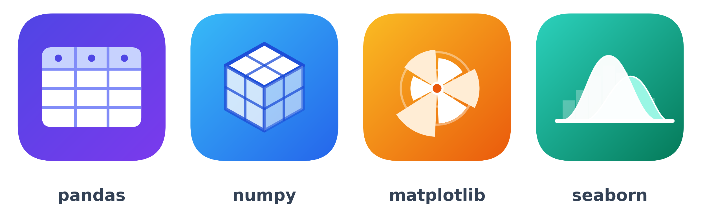
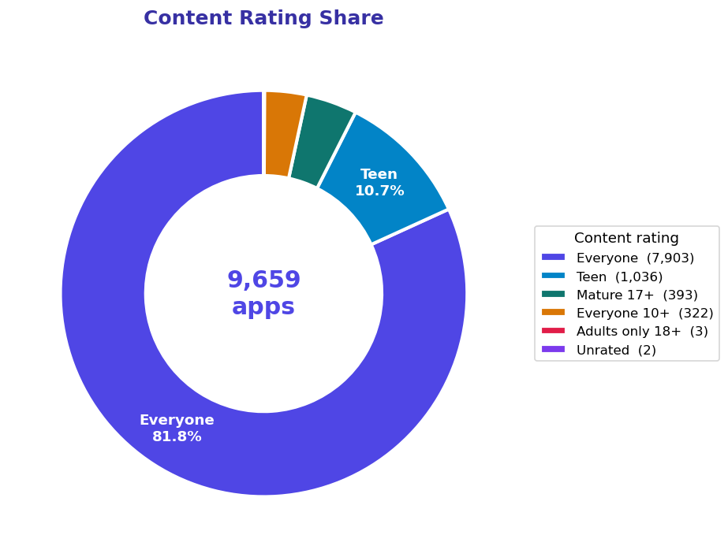
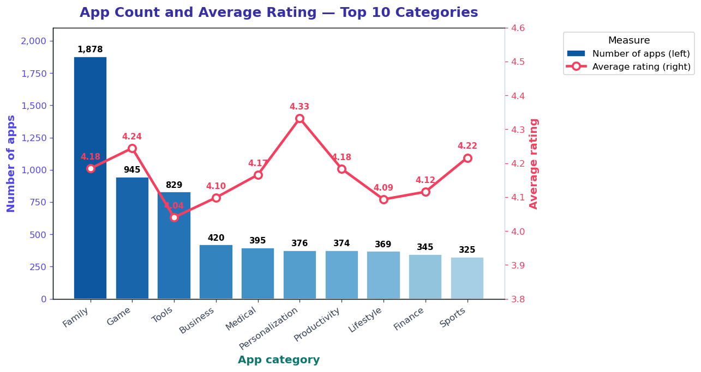
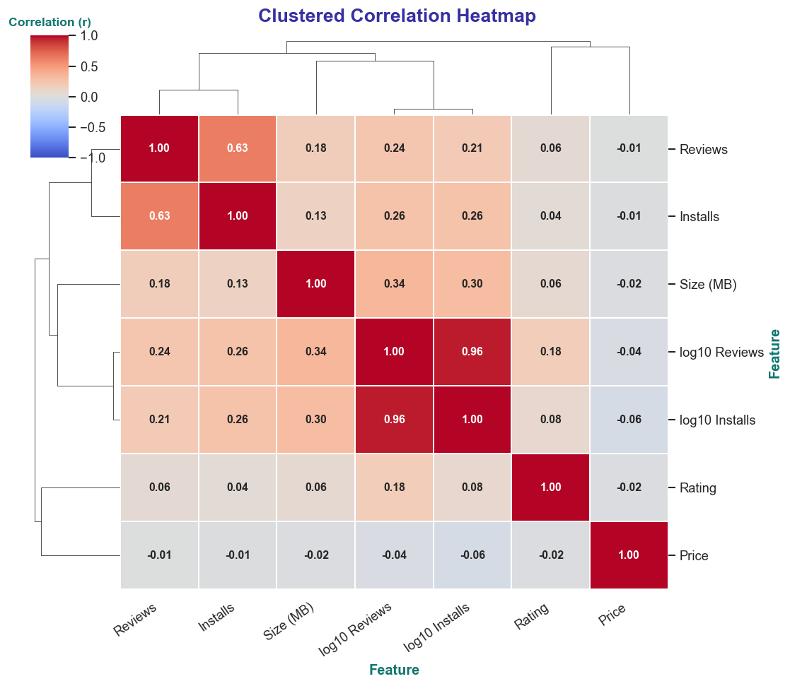
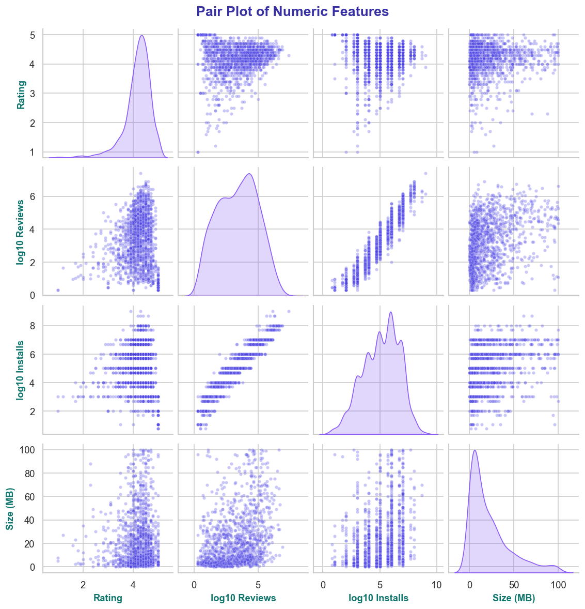

# Google Play Store Apps — Exploratory Data Analysis

<p align="center">
  
</p>

An end-to-end EDA project on the Google Play Store dataset using **pandas, NumPy, Matplotlib and Seaborn**.
The notebook has **229 numbered operations**, each with a short plain-English explanation:

| Library | Operations | Examples |
|---|---|---|
| 🐼 pandas | **80** | cleaning, `groupby`, `pivot_table`, `merge`, `resample`, `explode`, `qcut` |
| 🔢 NumPy | **52** | statistics, `where`, `polyfit`, bootstrap, broadcasting, z-score, IQR outliers |
| 📊 Matplotlib | **44** | bar, pie, donut, hexbin, polar, GridSpec, inset axes, annotations, twin axes |
| 🎨 Seaborn | **53** | `pairplot`, `jointplot`, `clustermap`, `FacetGrid`, `catplot`, split violins, heatmaps |

## 📂 Project structure

```
googleplaystore-eda/
├── Google_Play_Store_EDA.ipynb     # main notebook (already executed, outputs included)
├── data/
│   ├── googleplaystore.csv                 # raw apps data
│   ├── googleplaystore_user_reviews.csv    # raw user reviews
│   ├── googleplaystore_cleaned.csv         # created by the notebook
│   └── license.txt                         # CC BY 3.0
├── images/                         # every chart saved as PNG (+ one PDF/SVG example)
├── icons/                          # library icons and section banners used in the notebook / README
├── requirements.txt
└── README.md
```

## 🗂 Dataset

| File | Rows | Description |
|---|---|---|
| `googleplaystore.csv` | 10,841 | App name, category, rating, reviews, size, installs, type, price, content rating, genres, last updated, versions |
| `googleplaystore_user_reviews.csv` | 64,295 | App name, review text, sentiment label, polarity, subjectivity |

License: **Creative Commons Attribution 3.0 Unported** (see `data/license.txt`).

## 🧹 Data problems found and fixed

| Problem | Fix |
|---|---|
| One broken row (shifted columns, Category = `1.9`) | removed |
| 483 fully duplicated rows | `drop_duplicates()` |
| 698 apps repeated with different review counts | kept the row with the most reviews → **9,659 unique apps** |
| `Reviews`, `Installs`, `Size`, `Price` stored as text (`10,000+`, `19M`, `$4.99`) | cleaned and converted to numbers |
| `Last Updated` stored as text | converted to `datetime` |
| Missing `Type`, `Content Rating`, versions | filled (mode / `Unknown` / Free) |
| 1,400+ missing `Rating` values | kept as NaN (and an optional `Rating_filled` column) |
| `Size` = `Varies with device` | converted to NaN |

## 🔍 Key findings

- After cleaning there are **9,659 unique apps in 33 categories**; **92.2 %** are free.
- The biggest categories are **Family (1,878), Game (945) and Tools (829)**.
- Average rating is **4.17** (median **4.3**); the bootstrap 95 % interval for the mean is about 4.16 – 4.19.
- Highest average rating among categories with 50+ apps: **Events (4.44), Art & Design (4.36), Education (4.35)**.
- **Reviews and installs are almost perfectly related on a log scale** (correlation 0.96, slope ≈ 1.0), so an app with ~10,000 reviews is expected to have a few hundred thousand installs.
- Paid apps are rated slightly higher on average than free apps (4.26 vs 4.17), but there are far fewer of them.
- The median app is **12 MB**.
- **64 %** of user reviews are positive.
- Biggest estimated revenue (price × installs, ignoring in-app purchases): **Minecraft**, followed by the joke apps *I am rich* and *I Am Rich Premium*.

## 🎨 Chart styling

Every chart in the notebook has:

- **Coloured titles and axis labels** (indigo titles, teal x / y labels)
- **Multi-shade bars** — vertical and horizontal bar charts use colour gradients
- **Pie and donut charts with labels inside** the slices and a legend on the right
- **Legends placed outside the plot** (right side) so they never cover the data
- **Value labels** on bars, points and heatmap cells wherever exact numbers matter
- A short **"what it shows / how to read it"** explanation under every chart heading

## 🖼 Sample charts

| | |
|---|---|
|  |  |
|  |  |

## ▶️ How to run

```bash
git clone https://github.com/him-anshu019/googleplaystore-eda.git
cd googleplaystore-eda
pip install -r requirements.txt
jupyter notebook Google_Play_Store_EDA.ipynb
```

Run all cells from top to bottom. The notebook must be started from the project folder, because it reads `data/...` and saves charts to `images/`.

## 📝 Notes

- Estimated revenue is a rough number (price × installs). It ignores in-app purchases, taxes and refunds.
- The data is from 2018, so the results describe the store at that time.
